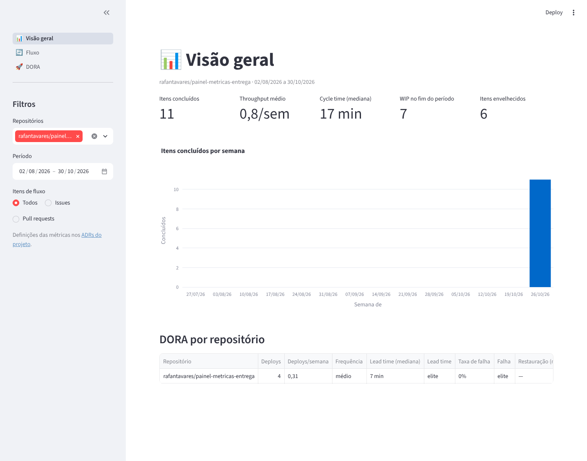

# 📊 Painel de Métricas de Entrega

> Dashboard que transforma dados do GitHub em indicadores de entrega — lead time, throughput, burndown e métricas DORA — para times que querem decidir com dados, não com achismo.

[](https://github.com/rafantavares/painel-metricas-entrega/actions/workflows/ci.yml)   

## Por que este projeto existe

Gerentes de projeto e tech leads costumam responder perguntas como *"estamos entregando mais rápido?"* ou *"o que está travando o time?"* com base em percepção. Os dados para responder já existem no GitHub (issues, PRs, releases, workflows), mas ficam espalhados.

Este painel coleta esses dados, calcula os indicadores e mostra tendências em um só lugar.

**Este repositório também é um estudo de caso de gestão:** o próprio projeto é conduzido com termo de abertura, roadmap, board no GitHub Projects, milestones, registros de decisão (ADRs) e retrospectivas — tudo versionado em [`docs/gestao`](docs/gestao).

## Métricas

| Grupo | Indicador | Pergunta que responde |
|---|---|---|
| **DORA** | Frequência de deploy | Com que frequência entregamos em produção? |
| | Lead time de mudanças | Quanto tempo da abertura do PR até ele chegar em produção? |
| | Taxa de falha de mudanças | Quantas entregas geram correção ou revert? |
| | Tempo de restauração (MTTR) | Quanto tempo levamos para resolver incidentes? |
| **Fluxo** | Throughput | Quantos itens concluímos por semana? |
| | Cycle time | Quanto tempo um item leva de "em andamento" a "pronto"? |
| | WIP e itens envelhecidos | O que está parado há tempo demais? |
| **Planejamento** | Burndown por milestone | Vamos cumprir o prazo da entrega? |
| | Previsibilidade | Quanto do planejado foi realmente entregue? |

## Arquitetura

```
GitHub API (REST/GraphQL)
        │
        ▼
  coletor (Python) ──► DuckDB (camadas bruta → tratada → métricas)
                                   │
                                   ▼
                       dashboard (Streamlit) + exportação CSV
```

- **Coleta incremental** com controle de rate limit e cache.
- **Cálculo das métricas** isolado em funções puras, com testes unitários.
- **Atualização agendada** via GitHub Actions.

## Stack

Python 3.12 · httpx · DuckDB · pandas · Streamlit · Plotly · pytest · Ruff · GitHub Actions

## Roadmap

| Milestone | Entrega | Status |
|---|---|---|
| **M1 – Fundação** | Estrutura do projeto, CI, coletor de issues e PRs | ✅ |
| **M2 – Métricas de fluxo** | Throughput, cycle time, WIP, aging | ✅ |
| **M3 – DORA** | As quatro métricas DORA a partir de releases/workflows | ✅ |
| **M4 – Dashboard** | Painel Streamlit com filtros por repo e período, deploy público | ⏳ |
| **M5 – Planejamento** | Burndown por milestone, previsibilidade, relatório semanal | ⏳ |

O detalhamento está nas [issues](../../issues) e no [board do projeto](../../projects).

## Como rodar

Pré-requisito: Python 3.12 ou superior.

```bash
git clone https://github.com/rafantavares/painel-metricas-entrega
cd painel-metricas-entrega
python -m venv .venv && source .venv/bin/activate   # no Windows: .venv\Scripts\activate
pip install -e ".[dev]"
cp .env.example .env   # informe GITHUB_TOKEN e os repositórios a analisar
```

As variáveis aceitas estão documentadas em [`.env.example`](.env.example).

### Coletar os dados

```bash
python -m painel.coletar
```

O coletor lê issues e pull requests de cada repositório em `PAINEL_REPOSITORIOS` e grava no arquivo DuckDB indicado em `PAINEL_BANCO` (padrão `data/painel.duckdb`):

- `bruta_itens`: uma linha por issue/PR, com datas de criação, atualização, fechamento e merge, labels e milestone;
- `bruta_deploys`: os deploys de cada repositório, identificados pela regra configurada;
- `controle_coleta`: até onde cada repositório já foi coletado.

**O que conta como deploy** é configurável por repositório em `PAINEL_REGRAS_DEPLOY`: release publicada (padrão), tag com um padrão de nome (`tag:v*`) ou execução bem-sucedida de um workflow (`workflow:deploy.yml@main`). Os critérios estão no [ADR 0004](docs/adr/0004-regra-de-deploy.md).

A coleta é incremental: a partir da segunda execução, só busca o que mudou desde a anterior. Quando a API devolve rate limit, o coletor espera e tenta de novo. Os detalhes estão no [ADR 0002](docs/adr/0002-coleta-incremental.md).

### Verificações de qualidade

```bash
ruff check .           # lint
ruff format --check .  # formatação
pytest                 # testes
```

Os mesmos comandos rodam no [CI](.github/workflows/ci.yml) a cada push na `main` e em todo pull request.

### Abrir o dashboard

```bash
streamlit run app/dashboard.py
```

O painel lê o mesmo arquivo DuckDB do coletor e tem três páginas:

- **Visão geral**: itens concluídos, throughput, cycle time, WIP, itens envelhecidos e o resumo DORA por repositório;
- **Fluxo**: throughput semanal, distribuição do cycle time, WIP diário e lista de itens envelhecidos;
- **DORA**: as quatro métricas por repositório, com a classificação de desempenho e os deploys por semana.

Os filtros ficam na barra lateral (repositórios, período e tipo de item), e cada tabela pode ser exportada em CSV.



## Atualização automática e publicação

- O workflow [`coleta.yml`](.github/workflows/coleta.yml) roda o coletor **a cada 6 horas** (ou manualmente, na aba Actions) e publica o banco na branch `dados`.
- O **painel público** fica no Streamlit Community Cloud e baixa esse banco a cada hora: **https://painel-metricas-entrega.streamlit.app**
- Os repositórios analisados e as regras de deploy da coleta agendada são variáveis do repositório: `PAINEL_REPOSITORIOS` e `PAINEL_REGRAS_DEPLOY`, em *Settings → Secrets and variables → Actions → Variables*. Sem elas, a coleta usa este repositório, com o CI na `main` como deploy.

Os motivos dessas escolhas estão no [ADR 0006](docs/adr/0006-atualizacao-e-publicacao.md).

<details>
<summary>Como publicar sua própria cópia</summary>

1. Faça um fork e rode o workflow **Coleta agendada** uma vez (aba *Actions → Coleta agendada → Run workflow*). Isso cria a branch `dados`.
2. Em [share.streamlit.io](https://share.streamlit.io), crie um app com:
   - repositório: o seu fork, branch `main`;
   - arquivo principal: `app/dashboard.py`;
   - em *Advanced settings*: Python 3.12 e, em *Secrets*:
     ```toml
     PAINEL_BANCO_URL = "https://raw.githubusercontent.com/<seu-usuario>/painel-metricas-entrega/dados/painel.duckdb"
     ```
3. Opcional: escolha um subdomínio personalizado em *Settings → General* do app.

</details>

## Gestão do projeto

- [Termo de abertura](docs/gestao/termo-de-abertura.md) — objetivo, escopo, riscos e critérios de sucesso
- [Decisões de arquitetura (ADRs)](docs/adr)
- [Retrospectivas](docs/gestao/retrospectivas)

## Autor

**Rafael Nunes Tavares** — estudante de Engenharia de Software (ULBRA Palmas)
[GitHub](https://github.com/rafantavares)

## Licença

[MIT](LICENSE)
